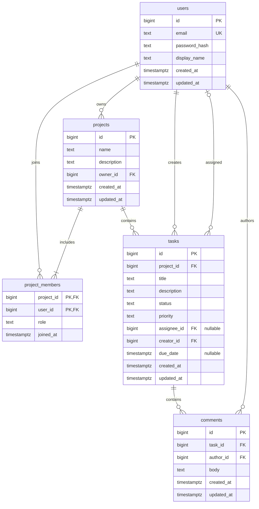
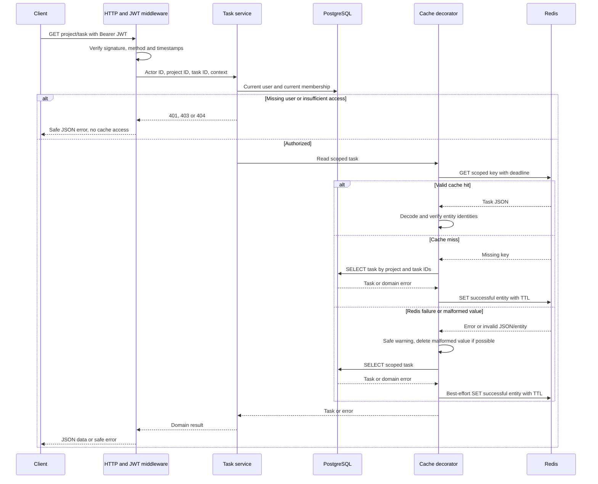

# TaskFlow architecture

## Layers and composition

`cmd/api/main.go` loads validated environment configuration, creates a lazy pgx
pool, repositories, JWT issuer/verifier, services and HTTP handlers. Optional
Redis detail decorators are injected only when `REDIS_ADDR` is nonempty. Chi
routes requests through structured logging/recovery and JWT middleware.

Handlers decode bounded JSON bodies/path/query inputs, call services and write
JSON envelopes. They contain no SQL or database-specific response types. Services
check users, membership, roles and domain invariants. Consumer-owned interfaces
permit small handwritten fakes. Repositories implement parameterized SQL and
atomic writes; database-specific errors map to domain errors. No ORM or global
mutable dependency registry is used.

`request.Context()` flows handler -> service -> repository/cache. PostgreSQL
operations derive bounded child contexts; Redis has connection, operation, socket
and pool-wait limits. Constructors retain dependencies/configuration, not request
contexts. Cancellation propagates instead of being replaced with a background
context during ordinary requests.

## Database model

PostgreSQL owns users, project access, task state and comments. All timestamps
are `TIMESTAMPTZ`, stored/read in UTC. IDs are generated bigint identities.

The project/member relationship requires an owner in the application creation
transaction. SQL enforces at most one owner membership with a partial unique
index, not a cross-table equality constraint between the owner role and
`projects.owner_id`. All public mutations preserve that relationship; direct
manual SQL can violate application-only invariants.

Unique normalized emails resolve concurrent registration safely. Composite
membership PKs prevent duplicates. Foreign keys reject orphaned references;
project deletion cascades memberships/tasks, task deletion cascades comments.
User references restrict deletion. Task assignees reference users, not a composite
membership key: same-project/current-membership assignment is rechecked under
the project lock, while historical assignment is retained after member removal.
Lengths/enums have database constraints in addition to service validation.

Indexes support member-to-project listing `(user_id, project_id)`, project task
listing/cascade `(project_id, id)` and task comment listing/cascade `(task_id, id)`.
There is no full-text index. Migration files 1-4 are immutable up/down pairs;
golang-migrate records the clean current version in `schema_migrations`.

## Authentication and authorization

Registration normalizes inputs and uses bcrypt default cost. Login verifies
the hash; missing users perform a dummy bcrypt comparison before returning the
same credential error as a wrong password. JWT verification requires HS256,
signature, expiration, issued-at and a positive decimal subject. Claims contain
no email, roles or password material. Access tokens expire; refresh/revocation
flows are outside scope.

Middleware establishes the actor ID. Services load the current user and live
project membership from PostgreSQL. For detail reads, membership's FK proves
project existence; a missing membership triggers a project lookup to distinguish
404 (missing project) from 403 (existing project, no access). Cache lookups happen
only after this check. Roles and ownership are never inferred from Redis or JWT
claims. Requests already in flight are not retroactively revoked.

## Transactions and concurrency

- Project creation inserts the project and owner membership in one transaction.
- Project/member writes lock the project row and recheck current roles.
- Task/comment writes take that same project lock, then lock/read the relevant
  child and recheck membership, permissions, assignment and status transitions.
  Locks are taken consistently with the project first. Independent projects can
  write concurrently; writes within a project serialize.
- Paginated count and rows use one read-only repeatable-read transaction. The
  total remains correct for an empty page. Separate requests can see new data.
- Repositories defer rollback, explicitly commit successes, close rows and check
  `rows.Err()`. A failed write rolls back its transaction.
- Cache invalidation follows successful database mutation; it is not part of
  the SQL transaction and cannot roll back committed data.

## Authenticated task-detail read

Only `GET` project/task detail entities are cached. Lists, queries, members,
comments, users, passwords, JWTs and authorization decisions always use their
ordinary PostgreSQL paths. Keys include project ID, and task keys include task
ID. Decoded cached IDs are checked. Errors/not-found results are not cached.

Default TTL is one minute. Mutations invalidate affected detail keys after
commit. Failed invalidation can leave stale values until expiry; an earlier read
can also refill stale data after deletion of a key. That fill's TTL bounds the
staleness. There are no locks across PostgreSQL and Redis, list caches, cache
warming or stampede suppression. Project cascades can leave unreachable task
keys until TTL. PostgreSQL authorization is checked even on cache hits.

## Failure behavior and lifecycle

| Failure | Behavior |
| --- | --- |
| Invalid environment / occupied HTTP address | Safe startup error and exit 1 |
| PostgreSQL down | Lazy pool permits HTTP startup and `/health`; `/ready` returns safe 503; database-backed operations return safe 500 |
| Missing/invalid/expired JWT | 401 with Bearer challenge; login credential 401 has the same safe body for unknown user/wrong password |
| Forbidden / missing resource | Domain error maps to 403 / 404 |
| Invalid input / conflict | 400 with field details when available / 409 |
| Unexpected SQL/service error | Internal error category logged, safe 500 returned; raw connection errors not logged |
| Redis read/write/invalidation failure | Bounded wait, safe warning; PostgreSQL result preserved |
| Handler panic | Call stack logged without panic value; safe 500 before response starts, otherwise abort connection |
| Client cancellation | Propagates through contexts; resources/transactions cleaned up |
| Shutdown deadline exceeded | Force HTTP closure, wait for serving goroutine, report error and exit 1 |

Signal handling cancels a root lifecycle context on Ctrl+C/SIGTERM. HTTP shutdown
uses a fresh bounded context because the signal context is already cancelled.
The server drains requests, then `run` returns and deferred Redis/pgx client
closures run. A buffered channel joins the serving goroutine. Clean shutdown
exits 0. Docker's stop grace period must exceed the HTTP shutdown deadline.

Logs are JSON through `slog`. Each request receives a server-generated
`X-Request-ID`; authenticated operations attach actor/project/task IDs when
available. Request completion logs contain status, byte count and duration.
Bodies, query strings, tokens, password data and authorization headers are not
logged. See [testing](testing.md) for behavior and concurrency checks, and
[OpenAPI](openapi.yaml) for the exact HTTP contract.
